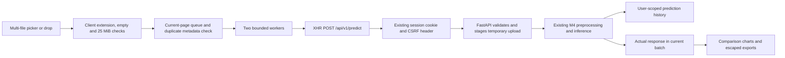
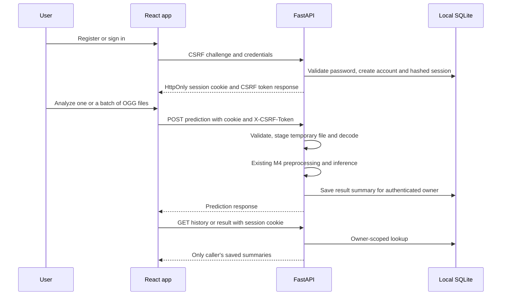

# M9 Frontend Architecture

## Application shape

The frontend is an isolated Vite app under `frontend/`; it does not alter the Python package layout. React Router owns the client-side routes. A shared application shell provides navigation, responsive mobile drawer behavior, page titles, API connection state, and status toasts.

```text
Browser
  ├─ Sign in/register ── cookie session + CSRF challenge
  ├─ Overview ─────────── GET /api/v1/health, GET /api/v1/models, account history
  ├─ Audio analysis ───── POST /api/v1/predict (multipart field: file)
  ├─ Prediction results ─ owner-scoped API history
  ├─ History/account ──── authenticated account endpoints
  ├─ Model information ─ experiment methods, limitations, and live API status
  └─ About BioSonic ───── workflow and scientific limitations
           │
           └─ Vite dev proxy (/api, /health) → FastAPI on 127.0.0.1:8000
```

## Modules

- `src/lib/api.ts`: typed API envelopes, auth/session actions, protected history requests, XHR multipart prediction with timeout and upload progress, and safe errors.
- `src/lib/history.ts`: legacy browser-local history helper retained for compatibility; new predictions do not use it.
- `src/types/api.ts`: frontend interfaces for model, auth, prediction, and history responses.
- `src/components/AuthProvider.tsx`: restores the current cookie session and keeps the CSRF token in React memory.
- `src/components/AuthGuards.tsx`: protects account routes and redirects authenticated users away from login/registration.
- `src/components/AppShell.tsx`: shared navigation, responsive sidebar, account menu, API health indicator, and toast context.
- `src/lib/analytics.ts`: pure account-history aggregation for activity by day, predicted-class frequency, duration bands, average duration, and recent-record ordering.
- `src/pages/DashboardPage.tsx`: combines live model/readiness API data with the current user's saved prediction history and renders responsive Recharts summaries.
- `src/pages/AnalysisPage.tsx`: keeps upload percentages tied to actual XHR upload events; while preparing or waiting for the server response it uses status text/indeterminate motion rather than invented inference progress.
- `src/pages/ResultsPage.tsx`: renders the API's returned class scores and recording metadata; playback is unavailable because audio is not retained by the backend.
- `src/components/WaveformPreview.tsx`: optional waveform generated from a browser-decoded local audio buffer; it is not a model feature.
- `src/pages/`: dashboard, upload/inference, results, model registry, and project context.
- `src/index.css`: Tailwind CSS v4 import/theme plus the application’s custom responsive visual system.

## Data and trust boundaries

The upload remains in browser memory and is submitted directly to the configured M8 endpoint. Client checks enforce filename extension, non-empty content, and the 25 MiB maximum; the backend remains authoritative for actual OGG/Vorbis decoding, mono/32 kHz format, and 1–180-second duration. The frontend does not set multipart `Content-Type` manually.

Local development uses Vite’s proxy for `/api` and `/health`, so no CORS middleware was added to the backend. For a hosted deployment, prefer a same-origin reverse proxy. If direct cross-origin access is required, configure a narrowly scoped backend allowlist before exposing the service.

M9 originally stored result summaries in browser local storage. M10.1 does not migrate or associate those legacy entries with an account. New prediction summaries are stored in the local API SQLite database and queried by authenticated user; uploaded audio is not stored. The browser receives an HttpOnly session cookie, while the CSRF token is kept only in React memory.

Dashboard analytics use only the authenticated `GET /api/v1/history` result (currently capped at the latest 100 rows). The activity chart groups those records by UTC calendar date; the class chart counts their returned top predictions; duration bands and the mean use `response.audio.duration_seconds`. An empty account displays explicit empty chart states. These are personal model-output summaries, not biodiversity or abundance measurements.

Responsive layouts use CSS breakpoints for wide screens, tablets, and mobile widths; the sidebar becomes a mobile drawer, chart grids collapse to a single column, and upload/result cards reflow. Transitions and keyframe animations are implemented in CSS, while chart entrance animation is provided by Recharts. The stylesheet honors `prefers-reduced-motion`. No animation package was added.

## API contract used

- Readiness: `{ status, models }` from `GET /api/v1/health`.
- Model inventory: `{ models: [{ id, task, status, version, classes, limitations, device }] }` from `GET /api/v1/models`.
- Prediction: `prediction_id`, `model`, `model_version`, `prediction`, `confidence`, `probabilities`, and `audio` metadata from authenticated `POST /api/v1/predict`.
- Authenticated history: `GET /api/v1/history` and `GET /api/v1/history/{prediction_id}`.
- Error envelope: `{ detail: { code, message } }`; the UI uses the server message where present and safe generic fallbacks otherwise.

The API currently serves only the M4 recording-level model. M3, M5, M6, and M7 are shown as research context, not as callable models. M7 remains experimental/research-only; reliable wildlife detection was not established.

## M10.2 checks and limitations

Dashboard/history derivation, empty states, upload validation/progress messaging, result rendering, authentication state, and routing have focused frontend tests. The production build runs TypeScript project compilation before Vite bundling. These checks do not replace manual browser interaction at desktop, tablet, and mobile sizes; no browser-driven visual audit is claimed.

## M10.3 signal-analysis architecture

`AnalysisPage` sends the selected original `File` to the existing prediction endpoint and passes the same local file to `AudioIntelligence` for a separate browser-only inspection path. An `AudioContext` decodes the file, decoded channels are averaged for display analysis, and a transferable `Float32Array` is sent to `signalAnalysis.worker.ts`. The worker returns numeric arrays and is terminated when the selected file changes or the page unmounts. The context is closed after decoding; the parent revokes its object URL when the file changes or the page unmounts. Audio is not sent to a new analysis API and browser signal metrics are not stored.

The waveform uses at most 1,200 min/max buckets to retain transients while avoiding one DOM point per sample. Playback uses native browser controls for play/pause, time, seek, and volume; a speed selector controls `playbackRate`. The canvas supports click-to-seek, keyboard-accessible range seek, and a centered waveform zoom selector. Plot work uses a worker and caps displayed STFT frames at 1,000.

| View | Exploratory parameters and interpretation |
|---|---|
| Waveform | Min/max envelope over time; decoded PCM amplitude. |
| Linear STFT | FFT 1,024; hop 256; symmetric Hann; complete frames only; linear bins from DC to Nyquist; power normalized against that file's maximum and displayed as `10 log10(P/max(P))`, floored at −80 dB. At 32 kHz the bin spacing is 31.25 Hz and hop spacing is 8 ms. |
| Mel | 128 triangular Slaney-spaced filters, Slaney area normalization, 0 to `min(16 kHz, Nyquist)`; same STFT power and per-file relative dB convention. |
| Spectrum | Mean magnitude across sampled STFT frames; dominant bin is the largest non-DC average magnitude. It is descriptive and cannot identify a species alone. |
| Signal summary | RMS is `sqrt(sum(x²)/N)`; mean is `sum(x)/N`; peak is `max(abs(x))`. Low-energy frames are 100 ms with 50 ms hop and are called low-energy when RMS `<0.005`. Clipping diagnostics count samples at `abs(x)≥0.99` and `abs(x)≥1`; these do not prove source clipping. |

The browser reports the filename/extension, byte size, decoded duration, decoded sample rate, and decoded channel count. Decoders may resample to the `AudioContext` rate; the UI labels these as decoded values rather than asserting original container metadata. Browser-decoded PCM does not expose trustworthy source bit depth, so it is not inferred. Audio visualization is not the model's exact frontend: M4 accepts verified mono 32 kHz OGG/Vorbis and uses its checkpoint-matched five-second Mel preprocessing and training normalizer. A file may display locally yet still be rejected by the API's stricter content checks.

## M10.4 batch request flow



The queue has per-file queued, validating, uploading, processing, completed, failed, and cancelled states. Upload percentage comes only from XHR `upload.onprogress`; after upload, the item is marked as waiting for the real API response. The API request includes the existing CSRF token and session cookie. Failures are isolated, failed files can be retried, and no new inference code or batch persistence table exists. CSV export contains filename, returned class/confidence/model/version/duration, status, and completion time. JSON export includes each successful prediction response and null for unsuccessful entries. Neither format includes local paths, cookies, passwords, or CSRF tokens.

Cancellation aborts the client request and marks not-yet-started queue entries cancelled. This does not prove server-side inference stopped after request bytes arrive; a result may still be persisted in that user's account history. Batch class distributions describe outputs for the current selection, not ecological abundance. The queue is in memory and is lost when the page is refreshed.

## End-to-end trust and authentication flows



Registration/login, CSRF, configured Origin validation, session revocation, and owner-scoped history remain implemented by M10.1 and are not bypassed by the batch page. Existing M8 API contract and M4 preprocessing are unchanged. Backend auth/M8 tests cover account isolation and history behavior; frontend component tests do not substitute for a real browser session.

## M10.3–M10.5 verification and presentation

Automated frontend tests cover calculation outputs, non-finite/empty input, bounded waveform data, queue validation and API-response rendering, batch exports, account UI, routing, and prior M10.2 flows. Oxlint and the production TypeScript/Vite build are run. Relevant backend checks use the existing auth/M8 API and M4 regression suites. No screenshot is synthesized and no browser-driven visual sign-off is claimed until an actual browser walk-through is completed at desktop, tablet, and mobile widths.
